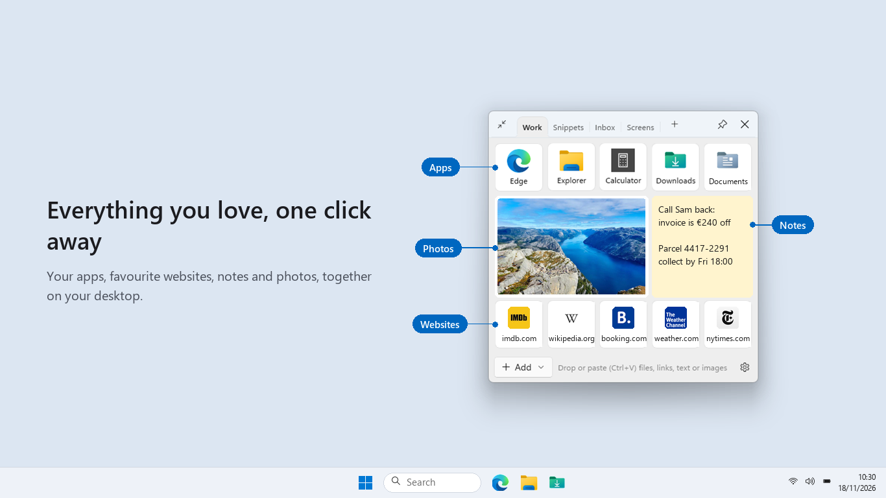
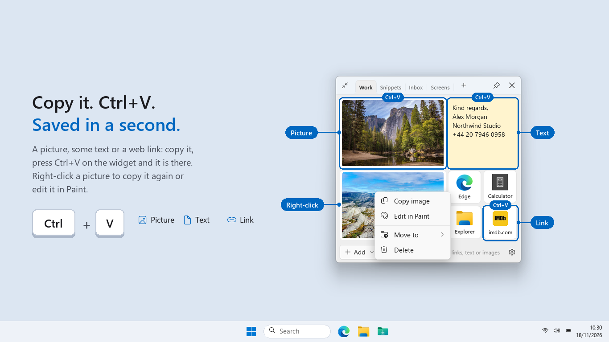
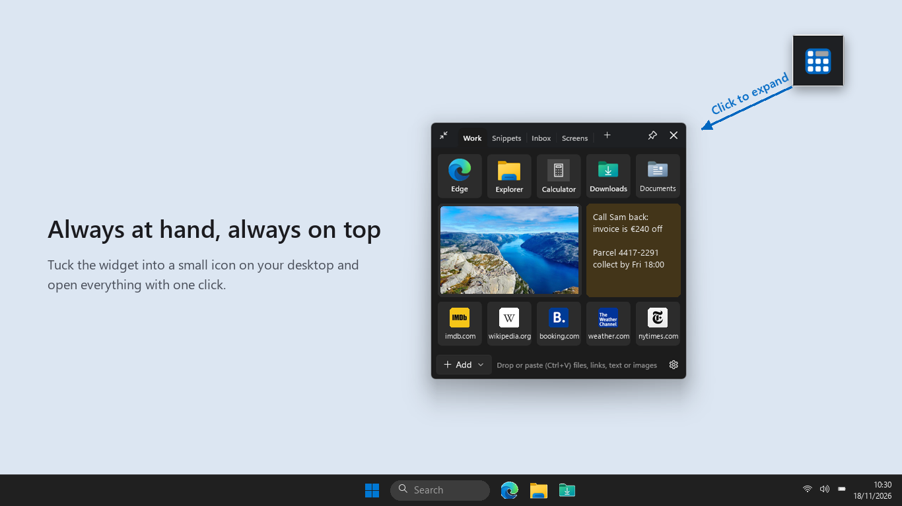

# My Everything Widget

A small Windows widget that keeps your apps, notes and images one click away.

> Rewritten with WinUI and .NET 10 for the Microsoft Store (MEW-4). The original Python/PySide6 version is in
> [`legacy/`](legacy/README.md); its data is imported automatically on first start.







## Features

- **A grid that stays put.** Drag cards anywhere on a fixed 5x5 grid; nothing slides around on its own. Dropping on
  another card swaps them; notes and images can span up to 3x3 cells.
- **Apps with their own icons.** Pick from the installed apps (desktop and Store), type a path or web address, or drop
  a file, folder or link on the widget. Change or reset a card's icon from its menu.
- **Notes and images.** Write a note, paste text or a screenshot with Ctrl+V, copy a note back with one click.
- **Categories.** Tabs you can add, rename, delete and reorder; move cards between them.
- **Windows 11 look.** Light and dark theme (or follow Windows), Mica, always on top.
- **Private.** Everything stays on your PC ([privacy policy](docs/general/PRIVACY_POLICY.md)).

## Development

See the [Development Guide](docs/general/DEVELOPMENT.md) and [Architecture](docs/general/ARCHITECTURE.md).

```
dotnet test                    # unit tests (Core, Presentation, Infrastructure)
pwsh scripts/test-ui.ps1       # UI tests in Windows Sandbox
pwsh scripts/publish-msix.ps1  # MSIX package
```

Publishing: [Store Submission](docs/general/STORE_SUBMISSION.md).

## License

MIT, see [LICENSE](LICENSE).
