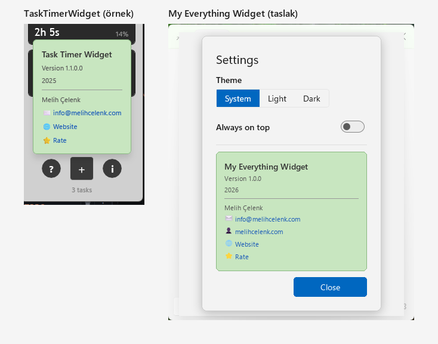

# S17 — About kartının taslağı: bu haliyle kodlayayım mı?

**Mevcut durum:** S16'ya göre taslak hazır (`mockups/mock-about-card.png`); kod değişmedi. Proje web sitesi (`index.html`) oluşturuldu.

**Soru:** Taslağı onaylıyor musun, yoksa neyi değiştireyim?

## Bağlam

### 2. taslakta değişenler (T51)

- **Ayarlar penceresi:** Daraldı; widget'ın içinde ortada, yaklaşık 300 px genişliğinde (önce 360).
- **Kart:** İçeriğin tam genişliğinde; sağında boşluk kalmıyor.
- **melihcelenk.com:** Geri eklendi. Sırası: ✉ e-posta, 👤 melihcelenk.com, 🌐 Website, ⭐ Rate.

### Taslak görseli

Solda TaskTimerWidget'taki kart (örnek), sağda Ayarlar penceresindeki yeni About kartının taslağı:

Yalnız taslak: [`mockups/mock-about-card.png`](../mockups/mock-about-card.png)

### Taslak (`mockups/mock-about-card.png`)

Ayarlar penceresinde, "Always on top" satırının altında, TaskTimerWidget'taki kartın aynısı:

| Öğe | Değer (TaskTimerWidget ile aynı) |
|-----|----------------------------------|
| Kart | Zemin #C8E6C0, çerçeve #88B880 (1 px), köşe 6 px, iç boşluk 14 px |
| Başlık | "My Everything Widget", 14 px, yarı kalın, #333333 |
| Satırlar | "Version 1.0.0" ve "2026" ayrı satırlarda, 11 px, #555555 |
| Ayırıcı | 1 px, #999999 |
| Geliştirici | "Melih Çelenk", 11 px, #555555 |
| Bağlantılar | 11 px, #1A5AB8: "✉ info@melihcelenk.com", "👤 melihcelenk.com", "🌐 Website", "⭐ Rate" |

- **E-posta:** Tıklayınca adres panoya kopyalanır ve kısa süre "Copied" görünür (T38).
- **Website:** Projenin GitHub Pages sitesi: `https://melihcelenk.github.io/MyEverythingWidget/`.
- **Rate:** Geçici olarak `https://apps.microsoft.com/search/publisher?name=Melih%20Celenk`.
- **Üzerine gelince:** Bütün bağlantıların ipucunda gittiği adres görünür.
- **Renkler:** Proje kuralı (yalnız tema kaynakları) gereği renkler koda yazılmaz; uygulamanın kaynak sözlüğünde
  adlandırılmış kaynaklar olarak tanımlanır (`AboutCardBackgroundBrush` gibi). Kart açık ve koyu temada aynı yeşil
  kalır.

### Kalkanlar

- GitHub bağlantısı ve gizlilik notu kalkar; web sitesi ikisine de bağlantı veriyor.

### Web sitesi (`index.html`, yapıldı)

- **Kaynak:** TaskTimerWidget'ın sayfasından uyarlandı.
- **İçerik:**
  - Logo ve başlık ("Everything you love, one click away").
  - Store ve GitHub düğmeleri.
  - Üç tanıtım görselinin kaydırmalı galerisi.
  - 8 özellik kartı ve gizlilik politikası bağlantısı.
- **Yayın:** Repo halka açılınca GitHub'da Pages açılmalı: **Settings → Pages → Branch: `master`, `/ (root)`**.
  Gizli repoda Pages ücretsiz planda çalışmaz.

## Seçenekler

### A — Taslaktaki gibi kodla ⭐

- Kart taslaktaki gibi yapılır; testler (kopyalama, ipuçları, sığma) yeni bağlantılara göre güncellenir.

### B — Değişiklik yap, yeni taslak göster

- Cevaba neyi değiştireceğimi yaz; yalnız taslağı yenilerim.

## Öneri

**A** — S16'daki bütün maddeler taslakta var.

## Cevap

## Sonuç

A uygulandı: kullanıcı taslağı terminalden onayladı ve uygulamaya başlanmasını istedi. Kart 2. taslaktaki gibi.

- **Ayarlar penceresi:** 300 px genişliğinde (içerik 252 px). Varsayılan widget boyutunda kaydırmasız sığıyor.
- **About kartı:**
  - TaskTimerWidget'taki yeşil kart, içeriğin tam genişliğinde.
  - Renkler `App.xaml`'da adlandırılmış kaynaklar (`AboutCard…Brush`), iki temada da aynı.
  - Başlık 14 px yarı kalın, satırlar ve bağlantılar 11 px.
  - "Version 1.0.0" ve "2026" ayrı satırlarda.
  - Bağlantılar: ✉ e-posta (tıklayınca kopyalanır, kısa süre ✔ "Copied" görünür), 👤 melihcelenk.com, 🌐 Website
    (proje sitesi), ⭐ Rate (Store yayıncı sayfası). Her birinin ipucunda gittiği adres var.
- **Testler:**
  - `AboutCard_IsTaskTimerWidgetsGreenCard_AsWideAsTheContent`: konum, genişlik ve renk.
  - `AboutLinks_TellWhereTheyGo` (4 bağlantı).
  - `SettingsDialog_KeepsAGapAboveAndBelow_AndShowsItAll`: kaydırma gerekmiyor.
  - Önce kırmızıydılar; şimdi `SettingsAndMigrationTests` 13/13 ve ayarlar düzeni testleri 3/3 geçiyor.
- **Ayrıntı:** `PHASE17.md` → 17.12.
